<p align="center">
  
</p>

<p align="center">
  <a href="https://www.linkedin.com/in/gabriel-santarena-98121227b/"></a>
  <a href="mailto:gabrielsantarena69@gmail.com"></a>
</p>

## 👨‍💻 Sobre mí

Desarrollo aplicaciones que resuelven problemas concretos: gestión de producción agropecuaria, sistemas de administración y automatizaciones. Trabajo de forma iterativa, empezando por los fundamentos y refinando sobre la marcha.

```yaml
estudio:   Tecnicatura Universitaria en Programación — UTN FRSR
front:     React + TypeScript
back:      Python · Java · Firebase
mobile:    Builds nativos Android con Capacitor
extra:     Automatizaciones con n8n e integración de APIs de IA
```

## 🛠️ Tecnologías

<p>
  
  
  
  
  
  <br/>
  
  
  
  
  
  <br/>
  
  
  
  
  
  <br/>
  
  
  
</p>

## 🤝 Proyectos en equipo

<p>
  <a href="https://github.com/HotCode2025/PI_TercerSemestre-ByteNine">
    
  </a>
  <a href="https://github.com/HotCode2025/Qwerty123-Cuarto-Semestre">
    
  </a>
</p>

**🏥 ByteNine — Sistema Médico Integrado.** Proyecto integrador de tercer semestre: pacientes, historias clínicas, turnos, recetas y usuarios, con interfaz en CustomTkinter y base PostgreSQL. Mi parte: módulo de Pacientes y revisión de código.

**📚 Qwerty123 — Cuarto semestre.** Repositorio del grupo con los trabajos de la cursada: un planificador de tareas con Java + Spring Boot y MySQL, un e-commerce cliente/servidor, una app PERN (PostgreSQL, Express, React, Node), un juego en Python y prácticas de JavaScript.

<!-- Próximos proyectos: copiar el bloque de arriba y agregar el paso correspondiente en .github/workflows/readme-cards.yml -->

## 📊 Estadísticas

<p align="center">
  
  
</p>

---

<p align="center"><sub>¿Trabajamos juntos? Escribime por LinkedIn o mail.</sub></p>
